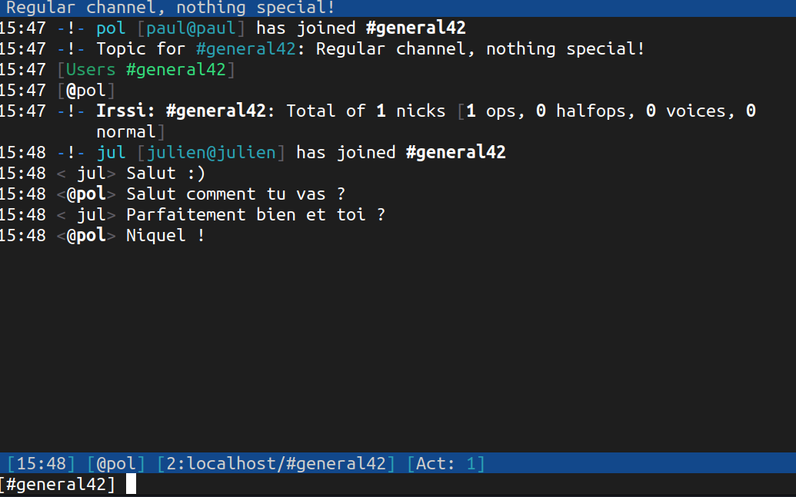
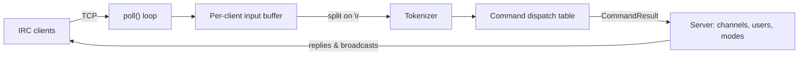

<h1 align="center">💬 ft_irc — burekserv</h1>

<p align="center">
  An IRC server written from scratch in C++98, compatible with real IRC clients such as Irssi.<br>
  <em>42 common core project.</em>
</p>

<p align="center">
  
  
  
</p>

> **My role — [ksssafcked](https://github.com/ksssafcked)**
> I built the protocol and application logic of the server: the message parser, user registration and the whole channel system.
> See [my contribution](#-my-contribution) for details.

<p align="center">
  
</p>

## 📖 About

**burekserv** is a single-threaded IRC server that handles many clients at once using non-blocking I/O and `poll()`. It implements the core of the IRC protocol (RFC 1459 / 2812): authentication, nicknames, channels, private messages and channel operator commands, and it works with a standard IRC client used as reference (Irssi).

## ✨ Features

- **Multi-client server** on a single thread, with one `poll()` loop handling all sockets
- **Non-blocking I/O** and per-client input buffers, so partial or fragmented messages are reassembled until a full `\r\n`-terminated line arrives
- **Password-protected connection** with a registration flow `PASS` → `NICK` / `USER`
- **Channels**: join, leave, topic, invitations and kicks, with channel operators
- **Private messages** to users and broadcast to channels
- **Standard numeric error replies** (`ERR_NICKNAMEINUSE`, `ERR_CHANOPRIVSNEEDED`, `ERR_NOTONCHANNEL`…)
- **Graceful shutdown** on `Ctrl+C` (SIGINT)
- A small easter egg: say *burek* in a channel and see who answers 🥐

### Supported commands

| Command   | Description                                   |
| --------- | --------------------------------------------- |
| `PASS`    | Authenticate with the server password         |
| `NICK`    | Set or change your nickname                   |
| `USER`    | Register your username                        |
| `CAP`     | Capability negotiation (for client handshake) |
| `JOIN`    | Join or create a channel                      |
| `PART`    | Leave a channel                               |
| `PRIVMSG` | Send a message to a user or a channel         |
| `TOPIC`   | View or change a channel topic                |
| `INVITE`  | Invite a user to a channel                    |
| `KICK`    | Remove a user from a channel *(operator)*     |
| `MODE`    | Change channel modes *(operator)*             |
| `PING`    | Keep the connection alive                     |
| `QUIT`    | Disconnect from the server                    |

### Channel modes

| Mode | Effect                                       |
| ---- | -------------------------------------------- |
| `i`  | Invite-only channel                          |
| `t`  | Only operators can change the topic          |
| `k`  | Channel password (key)                       |
| `o`  | Give or take operator privileges             |
| `l`  | Limit the number of users in the channel     |

## 🏗️ How It Works



Each client has its own buffer: incoming bytes are stored until a complete line is available, then tokenized and dispatched through a table mapping each command name to its handler. Handlers return a `CommandResult` describing what the server must do (reply to the sender, broadcast to a channel, kick, change mode…), which keeps protocol parsing separate from server state.

## 🚀 Getting Started

**Requirements:** a C++ compiler and `make`. [Irssi](https://irssi.org) is recommended as a client.

```bash
git clone https://github.com/ksssafcked/irc.git
cd irc
make
./build/bin/ircserv <port> <password>
```

### Connect with Irssi

```bash
irssi --connect=localhost -p <port> -w <password>
```

To try it quickly with two users, start the server with `./build/bin/ircserv 8080 4242`, then run `make a` and `make b` in two other terminals.

### Connect with netcat

Real clients open the handshake with `CAP LS 302`; the server answers with an empty capability list, so you can reproduce it or skip it:

```bash
nc -C localhost <port>
CAP LS 302
PASS <password>
NICK alice
USER alice alice
JOIN #general
PRIVMSG #general :Hello!
```

### Makefile targets

| Target        | Description                                                          |
| ------------- | -------------------------------------------------------------------- |
| `make`        | Build the server into `build/bin/ircserv`                            |
| `make debug`  | Build with debug logs enabled                                        |
| `make a` / `make b` | Connect two preconfigured Irssi users to a server on port `8080` (password `4242`) |

## 🧩 My Contribution

My teammate set up the socket layer; I built everything that turns raw bytes into IRC behavior.

**Parser**
- Per-client input buffering and reassembly of fragmented messages until a complete `\r\n` line is received
- Tokenizer handling commands, parameters and trailing `:message` arguments
- Command dispatch table and the `CommandResult` design, which keeps protocol parsing separate from server state

**User management**
- Registration flow `PASS` → `NICK` → `USER`, with password check before any other command
- Nickname and username validation, nickname changes and duplicate detection
- Standard numeric error replies sent back to clients

**Channels**
- `JOIN`, `PART`, `PRIVMSG`, `TOPIC`, `INVITE` and `KICK`, with operator privileges
- Channel modes `i`, `t`, `k`, `o` and `l`
- Message broadcasting to channel members and cleanup when users leave or disconnect

**Main challenge:** handling the many edge cases real clients produce (partial packets, unexpected separators, malformed commands) while staying compatible with Irssi's behavior.

## 👥 Team

| Member | Main contributions |
| ------ | ------------------ |
| **[ksssafcked](https://github.com/ksssafcked)** | Parser, command handling, user registration, channels and modes |
| **[jemal](https://github.com/jemal)** | Socket configuration and connection setup |
